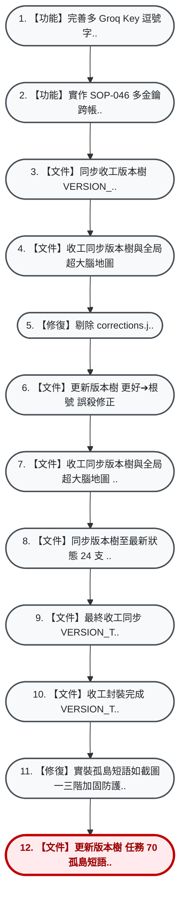

# 🌲 NoType 歷史版本樹 (Project Version Tree)

> **核心定位**：本文件與專案說明書 (`README.md` / `ANTIGRAVITY.md`) 具同等級核心地位。  
> 📌 **當前身處分支**：`main` (HEAD -> `7475ca1`)  
> 🚦 **工作區狀態**：⚠️ 有未存檔變更 (Dirty)  
> 🕒 **最後更新時間**：`2026-11-26 11:57:13`

---

### 1. 視覺化分支分岔樹 (Visual Branch Graph)
*註：垂直由上往下演進，主線以 1, 2, 3 編號，分岔以 1-1, 1-2, 1-1-1 階層式編號，清晰大字不擠壓。*



---

### 2. 時光機回溯與存檔對照表 (Time Machine & Commit Log)
*註：點選或複製時光機指令，可隨時一鍵跳轉回任一歷史版本。*

| 編號 (No.) | 存檔ID (Hash) | 提交時間 | 分支/標籤 | 說明 (Commit Message) | 時光機指令 (前往此版本) |
| :---: | :---: | :---: | :---: | :--- | :--- |
| **12** | `7475ca1` | 2026-11-24 16:35 |  `HEAD -> main, origin/main, origin/HEAD` | 【文件】更新版本樹 任務 70 孤島短語三階防護實裝 HEAD -> e918eec | `git checkout 7475ca1` |
| **11** | `e918eec` | 2026-11-24 16:35 |  | 【修復】實裝孤島短語如截圖一三階加固防護 Prompt先驗+LLM案例+物理秒殺兜底 任務 70 | `git checkout e918eec` |
| **10** | `af77786` | 2026-11-23 19:34 |  | 【文件】收工封裝完成 VERSION_TREE HEAD -> 2516eea | `git checkout af77786` |
| **9** | `2516eea` | 2026-11-23 19:33 |  | 【文件】最終收工同步 VERSION_TREE.md HEAD -> a3811e6 | `git checkout 2516eea` |
| **8** | `a3811e6` | 2026-11-23 19:27 |  | 【文件】同步版本樹至最新狀態 24 支 Gemini API 金鑰三軌負載平衡 | `git checkout a3811e6` |
| **7** | `297e9ec` | 2026-11-23 19:20 |  | 【文件】收工同步版本樹與全局超大腦地圖 任務 68 圓滿收工 | `git checkout 297e9ec` |
| **6** | `dc9d613` | 2026-11-23 19:12 |  | 【文件】更新版本樹 更好➔根號 誤殺修正 | `git checkout dc9d613` |
| **5** | `209af02` | 2026-11-23 19:12 |  | 【修復】剔除 corrections.json 倒置之 更好➔根號 映射，並強化 ambient 語境長度防護 任務 68 | `git checkout 209af02` |
| **4** | `bc83599` | 2026-11-23 16:45 |  | 【文件】收工同步版本樹與全局超大腦地圖 | `git checkout bc83599` |
| **3** | `c38586c` | 2026-11-23 16:07 |  | 【文件】同步收工版本樹 VERSION_TREE SOP-046 多金鑰交替平衡上線 | `git checkout c38586c` |
| **2** | `7373595` | 2026-11-23 16:07 |  | 【功能】實作 SOP-046 多金鑰跨帳號 1:1 交錯輪替負載平衡與旗艦模型優先保護機制 | `git checkout 7373595` |
| **1** | `4cc62de` | 2026-11-23 15:48 |  | 【功能】完善多 Groq Key 逗號字串讀取與全域多金鑰負載均衡支援 | `git checkout 4cc62de` |
| **-** | `7440da6` | 2026-11-23 14:26 |  | 【功能】補全電信預付卡詞庫 如意卡/易付卡 、注入玉復卡➔預付卡與盧亦卡➔如意卡同音自癒規則 | `git checkout 7440da6` |
| **-** | `bbc9770` | 2026-11-11 22:19 |  | 【文件】最終收工同步 VERSION_TREE 任務 65 完工收工 | `git checkout bbc9770` |
| **-** | `3c6dba7` | 2026-11-11 22:12 |  | 【功能】同步升級 Cloudflare Worker 溫度至 0.3、注入同音自癒 Prompt、支援情境感知替換規則 | `git checkout 3c6dba7` |
| **-** | `d768dea` | 2026-11-11 22:04 |  | 【功能】升級 LLM 溫度至 0.3、注入同音自癒 Prompt、重構 corrections.json 為情境感知規則根除誤傷 | `git checkout d768dea` |
| **-** | `5fb84f1` | 2026-11-11 18:42 |  | 【文件】最終收工同步 VERSION_TREE 任務 63, 64 | `git checkout 5fb84f1` |
| **-** | `b742715` | 2026-11-11 18:21 |  | 【修復】補強setup_new_pc之requirements.txt缺檔自動降級與相容防呆 | `git checkout b742715` |
| **-** | `8efb4a5` | 2026-11-11 16:15 |  | 【同步】更新版本樹 任務 64 | `git checkout 8efb4a5` |
| **-** | `f79b0ab` | 2026-11-11 16:15 |  | 【優化】實裝AI處理狀態懸浮窗、壓縮API逾時至3.2s並加入耗時透明診斷 任務 64 | `git checkout f79b0ab` |
| **-** | `c832e4a` | 2026-11-11 11:11 |  | 【修復】拔除DevNodesChanged正回授死循環、錄音啟動全面非同步線程化根治筆電卡頓與鍵盤癱瘓 任務 63 | `git checkout c832e4a` |
| **-** | `cc1d9fb` | 2026-10-28 22:32 |  | 【文件】最終收工同步 VERSION_TREE.md HEAD -> a018c1d | `git checkout cc1d9fb` |
| **-** | `a018c1d` | 2026-10-28 22:26 |  | 【文件】同步 VERSION_TREE.md 任務 62 完工收工 | `git checkout a018c1d` |
| **-** | `c39c580` | 2026-10-28 22:19 |  | 【修復】收工孤島指令0ms秒殺、Prompt 398 bytes精準收縮防稀釋與文培亦、陳金枝加回 任務 62 | `git checkout c39c580` |
| **-** | `534b345` | 2026-10-24 01:28 |  | 【文件】同步 VERSION_TREE.md 任務 61 完工收工 | `git checkout 534b345` |

---

### 3. 現存分支架構 (Active Branches)
- 🌿 `main` **(HEAD 當前所在)**

---

### 4. 終端完整拓撲圖 (Terminal ASCII Graph)
```text
* 7475ca1 (HEAD -> main, origin/main, origin/HEAD) 【文件】更新版本樹 任務 70 孤島短語三階防護實裝 (HEAD -> e918eec)
* e918eec 【修復】實裝孤島短語如截圖一三階加固防護 (Prompt先驗+LLM案例+物理秒殺兜底) 任務 70
* af77786 【文件】收工封裝完成 VERSION_TREE (HEAD -> 2516eea)
* 2516eea 【文件】最終收工同步 VERSION_TREE.md (HEAD -> a3811e6)
* a3811e6 【文件】同步版本樹至最新狀態 (24 支 Gemini API 金鑰三軌負載平衡)
* 297e9ec docs: 收工同步版本樹與全局超大腦地圖 (Task 68 圓滿收工)
* dc9d613 docs: 更新版本樹 (更好➔根號 誤殺修正)
* 209af02 fix: 剔除 corrections.json 倒置之 更好➔根號 映射，並強化 ambient 語境長度防護 (Task 68)
* bc83599 docs: 收工同步版本樹與全局超大腦地圖
* c38586c docs: 同步收工版本樹 VERSION_TREE (SOP-046 多金鑰交替平衡上線)
* 7373595 feat: 實作 SOP-046 多金鑰跨帳號 1:1 交錯輪替負載平衡與旗艦模型優先保護機制
* 4cc62de feat: 完善多 Groq Key 逗號字串讀取與全域多金鑰負載均衡支援
* 7440da6 feat: 補全電信預付卡詞庫(如意卡/易付卡)、注入玉復卡➔預付卡與盧亦卡➔如意卡同音自癒規則
* bbc9770 docs: 最終收工同步 VERSION_TREE 任務 65 完工收工
* 3c6dba7 feat(worker): 同步升級 Cloudflare Worker 溫度至 0.3、注入同音自癒 Prompt、支援情境感知替換規則
* d768dea feat: 升級 LLM 溫度至 0.3、注入同音自癒 Prompt、重構 corrections.json 為情境感知規則根除誤傷
* 5fb84f1 【文件】最終收工同步 VERSION_TREE (Task 63, 64)
* b742715 【修復】補強setup_new_pc之requirements.txt缺檔自動降級與相容防呆
* 8efb4a5 【同步】更新版本樹 (Task 64)
* f79b0ab 【優化】實裝AI處理狀態懸浮窗、壓縮API逾時至3.2s並加入耗時透明診斷 (Task 64)
* c832e4a 【修復】拔除DevNodesChanged正回授死循環、錄音啟動全面非同步線程化根治筆電卡頓與鍵盤癱瘓 (Task 63)
* cc1d9fb 【文件】最終收工同步 VERSION_TREE.md HEAD -> a018c1d
* a018c1d 【文件】同步 VERSION_TREE.md (Task 62 完工收工)
* c39c580 【修復】收工孤島指令0ms秒殺、Prompt 398 bytes精準收縮防稀釋與文培亦、陳金枝加回 (Task 62)
* 534b345 【文件】同步 VERSION_TREE.md (Task 61 完工收工)
```

---
*💡 由全域工具 `git_version_tree.py` 自動生成與維護，每次收工自動同步更新。*
