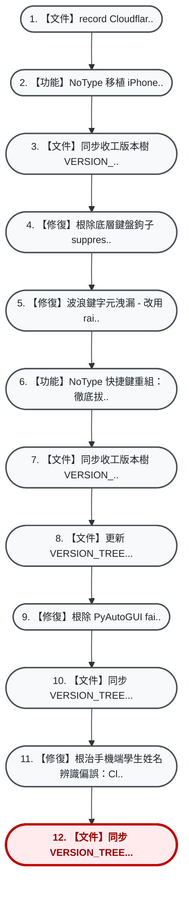

# 🌲 NoType 歷史版本樹 (Project Version Tree)

> **核心定位**：本文件與專案說明書 (`README.md` / `ANTIGRAVITY.md`) 具同等級核心地位。  
> 📌 **當前身處分支**：`main` (HEAD -> `b75d44f`)  
> 🚦 **工作區狀態**：✅ 工作目錄整潔 (Clean)  
> 🕒 **最後更新時間**：`2026-10-19 01:47:13`

---

### 1. 視覺化分支分岔樹 (Visual Branch Graph)
*註：垂直由上往下演進，主線以 1, 2, 3 編號，分岔以 1-1, 1-2, 1-1-1 階層式編號，清晰大字不擠壓。*



---

### 2. 時光機回溯與存檔對照表 (Time Machine & Commit Log)
*註：點選或複製時光機指令，可隨時一鍵跳轉回任一歷史版本。*

| 編號 (No.) | 存檔ID (Hash) | 提交時間 | 分支/標籤 | 說明 (Commit Message) | 時光機指令 (前往此版本) |
| :---: | :---: | :---: | :---: | :--- | :--- |
| **12** | `b75d44f` | 2026-10-19 01:23 |  `HEAD -> main, origin/main, origin/HEAD` | 【文件】同步 VERSION_TREE.md 歷史版本樹 e1c1c9f | `git checkout b75d44f` |
| **11** | `e1c1c9f` | 2026-10-19 01:23 |  | 【修復】根治手機端學生姓名辨識偏誤：Cloudflare Worker 更換在線模型輪詢容錯、人名獨立提權最高 Prompt、自癒映射注入文培亦與物件替換防護 | `git checkout e1c1c9f` |
| **10** | `9480dc7` | 2026-10-15 10:18 |  | 【文件】同步 VERSION_TREE.md 歷史版本樹 9ebe870 | `git checkout 9480dc7` |
| **9** | `9ebe870` | 2026-10-15 10:18 |  | 【修復】根除 PyAutoGUI fail-safe 角落貼上阻截，Prompt Token 瘦身 65% 並加固 Groq 429 自癒冷卻 | `git checkout 9ebe870` |
| **8** | `d139599` | 2026-10-09 20:19 |  | 【文件】更新 VERSION_TREE.md 拓撲圖 | `git checkout d139599` |
| **7** | `fde5927` | 2026-10-09 20:18 |  | 【文件】同步收工版本樹 VERSION_TREE.md | `git checkout fde5927` |
| **6** | `112030c` | 2026-10-09 20:18 |  | 【功能】NoType 快捷鍵重組：徹底拔除 F8 統一為 Alt + ~，第 1 點標題調整為 ~ 波浪鍵 居首 | `git checkout 112030c` |
| **5** | `3a6b4ee` | 2026-09-30 20:00 |  | 【修復】波浪鍵字元洩漏 - 改用 raise SuppressException 真正阻截 Windows 事件 | `git checkout 3a6b4ee` |
| **4** | `e2bc0e4` | 2026-09-30 19:25 |  | 【修復】根除底層鍵盤鉤子 suppress_event 異常，消除筆電 Windows 修飾鍵 Alt 卡死與鍵盤錯亂 | `git checkout e2bc0e4` |
| **3** | `7723cba` | 2026-09-28 16:00 |  | 【文件】同步收工版本樹 VERSION_TREE.md | `git checkout 7723cba` |
| **2** | `58bbc8c` | 2026-09-28 15:57 |  | 【功能】NoType 移植 iPhone 語音輸入方案 B 圓滿收官：Cloudflare Worker 動態中繼、iOS 雙手勢快捷輸入與 SayIt 歷史抽屜落成 | `git checkout 58bbc8c` |
| **1** | `47c4704` | 2026-09-28 13:49 |  | 【文件】record Cloudflare account hjen84@gmail.com | `git checkout 47c4704` |
| **-** | `18e4ca1` | 2026-09-28 13:44 |  | 【功能】add 版本樹 to dictionary 與 corrections | `git checkout 18e4ca1` |
| **-** | `a05b1df` | 2026-09-28 13:44 |  | 【功能】add Cloudflare Worker relay 與 iOS shortcut deployment guide without secrets | `git checkout a05b1df` |
| **-** | `4a3ea27` | 2026-09-28 02:49 |  | 【維護】update requirements.txt | `git checkout 4a3ea27` |
| **-** | `4c9bcd5` | 2026-09-28 02:49 |  | 【修復】remove mainland term 與 update dictionary data | `git checkout 4c9bcd5` |
| **-** | `5661482` | 2026-09-28 02:44 |  | 【修復】timestamp-based sync to fix deleted dictionary words resurrecting | `git checkout 5661482` |
| **-** | `c08b18c` | 2026-09-28 02:28 |  | 【功能】bidirectional dictionary smart merge 與 notebook 自動-start on boot | `git checkout c08b18c` |
| **-** | `0839abd` | 2026-09-27 21:11 |  | 【功能】completely excise Shift+F8, promote Ctrl+~ as sole unconflicted hotkey 針對 quick learn | `git checkout 0839abd` |
| **-** | `1ebb0ec` | 2026-09-27 20:57 |  | 【功能】clean F9 from main.py startup banner 與 reorder hotkeys | `git checkout 1ebb0ec` |
| **-** | `672623f` | 2026-09-27 20:56 |  | 【功能】excise F9 key, reorder hotkeys 1:Alt/~, 2:Shift+F8/Ctrl+~, 3:F8/Alt+~ , 與 implement window geometry memory 針對 history, dictionary, help, 與 quick learn | `git checkout 672623f` |
| **-** | `3c88006` | 2026-09-27 18:53 |  | 【修復】enlarge dictionary manager 與 help guide, enable mouse resizing 搭配 scrollable canvas | `git checkout 3c88006` |
| **-** | `6f817fc` | 2026-09-27 18:47 |  | 【修復】enlarge quick learn 與 history panel dimensions 與 font scaling 針對 laptops | `git checkout 6f817fc` |
| **-** | `25b4a7e` | 2026-09-27 18:35 |  | 【修復】make Ctrl+~ open quick learn even without text selection, 與 add fallback modifier checks | `git checkout 25b4a7e` |
| **-** | `0bf9733` | 2026-09-27 18:11 |  | 【功能】add Ctrl+~ 針對 quick learn 與 Alt+~ 針對 rephrase laptop Fn-free 支援 | `git checkout 0bf9733` |

---

### 3. 現存分支架構 (Active Branches)
- 🌿 `main` **(HEAD 當前所在)**

---

### 4. 終端完整拓撲圖 (Terminal ASCII Graph)
```text
* b75d44f (HEAD -> main, origin/main, origin/HEAD) 【文件】同步 VERSION_TREE.md 歷史版本樹 (e1c1c9f)
* e1c1c9f 【修復】根治手機端學生姓名辨識偏誤：Cloudflare Worker 更換在線模型輪詢容錯、人名獨立提權最高 Prompt、自癒映射注入文培亦與物件替換防護
* 9480dc7 【文件】同步 VERSION_TREE.md 歷史版本樹 (9ebe870)
* 9ebe870 【修復】根除 PyAutoGUI fail-safe 角落貼上阻截，Prompt Token 瘦身 65% 並加固 Groq 429 自癒冷卻
* d139599 【文件】更新 VERSION_TREE.md 拓撲圖
* fde5927 【文件】同步收工版本樹 VERSION_TREE.md
* 112030c 【功能】NoType 快捷鍵重組：徹底拔除 F8 統一為 Alt + ~，第 1 點標題調整為 ~ (波浪鍵) 居首
* 3a6b4ee 【修復】波浪鍵字元洩漏 - 改用 raise SuppressException 真正阻截 Windows 事件
* e2bc0e4 【修復】根除底層鍵盤鉤子 suppress_event 異常，消除筆電 Windows 修飾鍵 Alt 卡死與鍵盤錯亂
* 7723cba 【文件】同步收工版本樹 VERSION_TREE.md
* 58bbc8c 【功能】NoType 移植 iPhone 語音輸入方案 B 圓滿收官：Cloudflare Worker 動態中繼、iOS 雙手勢快捷輸入與 SayIt 歷史抽屜落成
* 47c4704 docs: record Cloudflare account hjen84@gmail.com
* 18e4ca1 feat(dict): add 版本樹 to dictionary and corrections
* a05b1df feat(ios): add Cloudflare Worker relay and iOS shortcut deployment guide without secrets
* 4a3ea27 chore: update requirements.txt
* 4c9bcd5 fix(dict): remove mainland term and update dictionary data
* 5661482 fix(sync): timestamp-based sync to fix deleted dictionary words resurrecting
* c08b18c feat(sync): bidirectional dictionary smart merge and notebook auto-start on boot
* 0839abd feat: completely excise Shift+F8, promote Ctrl+~ as sole unconflicted hotkey for quick learn
* 1ebb0ec feat: clean F9 from main.py startup banner and reorder hotkeys
* 672623f feat: excise F9 key, reorder hotkeys (1:Alt/~, 2:Shift+F8/Ctrl+~, 3:F8/Alt+~), and implement window geometry memory for history, dictionary, help, and quick learn
* 3c88006 fix(ui): enlarge dictionary manager and help guide, enable mouse resizing with scrollable canvas
* 6f817fc fix(ui): enlarge quick learn and history panel dimensions and font scaling for laptops
* 25b4a7e fix: make Ctrl+~ open quick learn even without text selection, and add fallback modifier checks
* 0bf9733 feat: add Ctrl+~ for quick learn and Alt+~ for rephrase (laptop Fn-free support)
```

---
*💡 由全域工具 `git_version_tree.py` 自動生成與維護，每次收工自動同步更新。*
