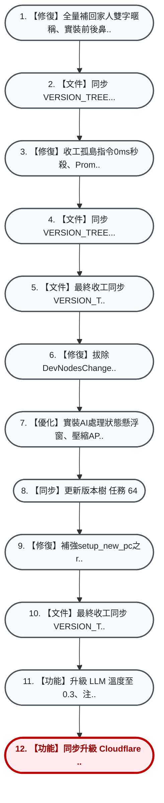

# 🌲 NoType 歷史版本樹 (Project Version Tree)

> **核心定位**：本文件與專案說明書 (`README.md` / `ANTIGRAVITY.md`) 具同等級核心地位。  
> 📌 **當前身處分支**：`main` (HEAD -> `3c6dba7`)  
> 🚦 **工作區狀態**：✅ 工作目錄整潔 (Clean)  
> 🕒 **最後更新時間**：`2026-11-11 22:12:59`

---

### 1. 視覺化分支分岔樹 (Visual Branch Graph)
*註：垂直由上往下演進，主線以 1, 2, 3 編號，分岔以 1-1, 1-2, 1-1-1 階層式編號，清晰大字不擠壓。*



---

### 2. 時光機回溯與存檔對照表 (Time Machine & Commit Log)
*註：點選或複製時光機指令，可隨時一鍵跳轉回任一歷史版本。*

| 編號 (No.) | 存檔ID (Hash) | 提交時間 | 分支/標籤 | 說明 (Commit Message) | 時光機指令 (前往此版本) |
| :---: | :---: | :---: | :---: | :--- | :--- |
| **12** | `3c6dba7` | 2026-11-11 22:12 |  `HEAD -> main, origin/main, origin/HEAD` | 【功能】同步升級 Cloudflare Worker 溫度至 0.3、注入同音自癒 Prompt、支援情境感知替換規則 | `git checkout 3c6dba7` |
| **11** | `d768dea` | 2026-11-11 22:04 |  | 【功能】升級 LLM 溫度至 0.3、注入同音自癒 Prompt、重構 corrections.json 為情境感知規則根除誤傷 | `git checkout d768dea` |
| **10** | `5fb84f1` | 2026-11-11 18:42 |  | 【文件】最終收工同步 VERSION_TREE 任務 63, 64 | `git checkout 5fb84f1` |
| **9** | `b742715` | 2026-11-11 18:21 |  | 【修復】補強setup_new_pc之requirements.txt缺檔自動降級與相容防呆 | `git checkout b742715` |
| **8** | `8efb4a5` | 2026-11-11 16:15 |  | 【同步】更新版本樹 任務 64 | `git checkout 8efb4a5` |
| **7** | `f79b0ab` | 2026-11-11 16:15 |  | 【優化】實裝AI處理狀態懸浮窗、壓縮API逾時至3.2s並加入耗時透明診斷 任務 64 | `git checkout f79b0ab` |
| **6** | `c832e4a` | 2026-11-11 11:11 |  | 【修復】拔除DevNodesChanged正回授死循環、錄音啟動全面非同步線程化根治筆電卡頓與鍵盤癱瘓 任務 63 | `git checkout c832e4a` |
| **5** | `cc1d9fb` | 2026-10-28 22:32 |  | 【文件】最終收工同步 VERSION_TREE.md HEAD -> a018c1d | `git checkout cc1d9fb` |
| **4** | `a018c1d` | 2026-10-28 22:26 |  | 【文件】同步 VERSION_TREE.md 任務 62 完工收工 | `git checkout a018c1d` |
| **3** | `c39c580` | 2026-10-28 22:19 |  | 【修復】收工孤島指令0ms秒殺、Prompt 398 bytes精準收縮防稀釋與文培亦、陳金枝加回 任務 62 | `git checkout c39c580` |
| **2** | `534b345` | 2026-10-24 01:28 |  | 【文件】同步 VERSION_TREE.md 任務 61 完工收工 | `git checkout 534b345` |
| **1** | `c88210e` | 2026-10-24 01:28 |  | 【修復】全量補回家人雙字暱稱、實裝前後鼻音 信之➔杏枝 秒殺與Prompt 640bytes配額 任務 61 | `git checkout c88210e` |
| **-** | `0998c9e` | 2026-10-23 23:21 |  | 【優化】實裝三道物理安全鎖：進程提權 HIGH、鍵盤線程提權 HIGHEST、系統匣新增一鍵重新掛載鉤子 | `git checkout 0998c9e` |
| **-** | `de0f9ca` | 2026-10-23 22:29 |  | 【文件】同步 VERSION_TREE.md 任務 60 完工收工 | `git checkout de0f9ca` |
| **-** | `01556eb` | 2026-10-23 22:29 |  | 【修復】工作核心指令第0順位常駐鎖死、Prompt聚焦460bytes與爸爸葯語意消歧義 任務 60 | `git checkout 01556eb` |
| **-** | `796160e` | 2026-10-22 12:55 |  | 【文件】最終收工同步 VERSION_TREE.md HEAD -> 3fd94e8 | `git checkout 796160e` |
| **-** | `3fd94e8` | 2026-10-22 12:55 |  | 【修復】徹底移除貼上管線 Esc 鍵干擾 根治 PowerPoint 游標插入文字誤觸全選形狀整段遭覆蓋替換 | `git checkout 3fd94e8` |
| **-** | `3b1109f` | 2026-10-22 09:13 |  | 【文件】最終收工同步 VERSION_TREE.md HEAD -> 8774d72 | `git checkout 3b1109f` |
| **-** | `8774d72` | 2026-10-22 09:12 |  | 【修復】實裝錄音狀態感知防踩踏安全閥與異質應用焦點隔離 根治 DevNodesChanged 中斷與 VSCode/Antigravity 對話框失焦 | `git checkout 8774d72` |
| **-** | `84b947b` | 2026-10-21 23:05 |  | 【文件】最終收工同步 VERSION_TREE.md | `git checkout 84b947b` |
| **-** | `e84eb66` | 2026-10-21 22:31 |  | 【文件】同步 VERSION_TREE.md 版本樹 | `git checkout e84eb66` |
| **-** | `aef1404` | 2026-10-21 22:30 |  | 【修復】徹底根除 Alt 鍵盤狀態卡死 根治 ~ 誤判反白修飾與 OneNote 自動貼上失效，並永久保全剪貼簿 | `git checkout aef1404` |
| **-** | `95a7624` | 2026-10-21 21:53 |  | 【文件】同步 VERSION_TREE.md 版本樹 | `git checkout 95a7624` |
| **-** | `a22a9d3` | 2026-10-21 21:52 |  | 【修復】UPDATE_NOTEBOOK.bat 智慧探測 Dropbox 目錄、內建 GitHub 回退與 run_hidden.vbs 硬性保全 | `git checkout a22a9d3` |
| **-** | `2a21125` | 2026-10-21 21:39 |  | 【文件】同步 VERSION_TREE.md 版本樹 | `git checkout 2a21125` |

---

### 3. 現存分支架構 (Active Branches)
- 🌿 `main` **(HEAD 當前所在)**

---

### 4. 終端完整拓撲圖 (Terminal ASCII Graph)
```text
* 3c6dba7 (HEAD -> main, origin/main, origin/HEAD) feat(worker): 同步升級 Cloudflare Worker 溫度至 0.3、注入同音自癒 Prompt、支援情境感知替換規則
* d768dea feat: 升級 LLM 溫度至 0.3、注入同音自癒 Prompt、重構 corrections.json 為情境感知規則根除誤傷
* 5fb84f1 【文件】最終收工同步 VERSION_TREE (Task 63, 64)
* b742715 【修復】補強setup_new_pc之requirements.txt缺檔自動降級與相容防呆
* 8efb4a5 【同步】更新版本樹 (Task 64)
* f79b0ab 【優化】實裝AI處理狀態懸浮窗、壓縮API逾時至3.2s並加入耗時透明診斷 (Task 64)
* c832e4a 【修復】拔除DevNodesChanged正回授死循環、錄音啟動全面非同步線程化根治筆電卡頓與鍵盤癱瘓 (Task 63)
* cc1d9fb 【文件】最終收工同步 VERSION_TREE.md HEAD -> a018c1d
* a018c1d 【文件】同步 VERSION_TREE.md (Task 62 完工收工)
* c39c580 【修復】收工孤島指令0ms秒殺、Prompt 398 bytes精準收縮防稀釋與文培亦、陳金枝加回 (Task 62)
* 534b345 【文件】同步 VERSION_TREE.md (Task 61 完工收工)
* c88210e 【修復】全量補回家人雙字暱稱、實裝前後鼻音(信之➔杏枝)秒殺與Prompt 640bytes配額 (Task 61)
* 0998c9e 【優化】實裝三道物理安全鎖：進程提權 HIGH、鍵盤線程提權 HIGHEST、系統匣新增一鍵重新掛載鉤子
* de0f9ca 【文件】同步 VERSION_TREE.md (Task 60 完工收工)
* 01556eb 【修復】工作核心指令第0順位常駐鎖死、Prompt聚焦460bytes與爸爸葯語意消歧義 (Task 60)
* 796160e docs: 最終收工同步 VERSION_TREE.md (HEAD -> 3fd94e8)
* 3fd94e8 fix(keyboard): 徹底移除貼上管線 Esc 鍵干擾 (根治 PowerPoint 游標插入文字誤觸全選形狀整段遭覆蓋替換)
* 3b1109f docs: 最終收工同步 VERSION_TREE.md (HEAD -> 8774d72)
* 8774d72 fix(audio): 實裝錄音狀態感知防踩踏安全閥與異質應用焦點隔離 (根治 DevNodesChanged 中斷與 VSCode/Antigravity 對話框失焦)
* 84b947b docs: 最終收工同步 VERSION_TREE.md
* e84eb66 docs: 同步 VERSION_TREE.md 版本樹
* aef1404 fix(keyboard): 徹底根除 Alt 鍵盤狀態卡死 (根治 ~ 誤判反白修飾與 OneNote 自動貼上失效，並永久保全剪貼簿)
* 95a7624 docs: 同步 VERSION_TREE.md 版本樹
* a22a9d3 fix(update): UPDATE_NOTEBOOK.bat 智慧探測 Dropbox 目錄、內建 GitHub 回退與 run_hidden.vbs 硬性保全
* 2a21125 docs: 同步 VERSION_TREE.md 版本樹
```

---
*💡 由全域工具 `git_version_tree.py` 自動生成與維護，每次收工自動同步更新。*
