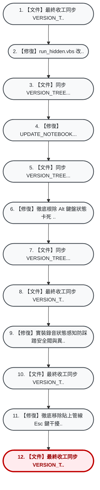

# 🌲 NoType 歷史版本樹 (Project Version Tree)

> **核心定位**：本文件與專案說明書 (`README.md` / `ANTIGRAVITY.md`) 具同等級核心地位。  
> 📌 **當前身處分支**：`main` (HEAD -> `6205a34`)  
> 🚦 **工作區狀態**：✅ 工作目錄整潔 (Clean)  
> 🕒 **最後更新時間**：`2026-10-22 12:55:19`

---

### 1. 視覺化分支分岔樹 (Visual Branch Graph)
*註：垂直由上往下演進，主線以 1, 2, 3 編號，分岔以 1-1, 1-2, 1-1-1 階層式編號，清晰大字不擠壓。*



---

### 2. 時光機回溯與存檔對照表 (Time Machine & Commit Log)
*註：點選或複製時光機指令，可隨時一鍵跳轉回任一歷史版本。*

| 編號 (No.) | 存檔ID (Hash) | 提交時間 | 分支/標籤 | 說明 (Commit Message) | 時光機指令 (前往此版本) |
| :---: | :---: | :---: | :---: | :--- | :--- |
| **12** | `6205a34` | 2026-10-22 12:55 |  `HEAD -> main` | 【文件】最終收工同步 VERSION_TREE.md HEAD -> 3fd94e8 | `git checkout 6205a34` |
| **11** | `3fd94e8` | 2026-10-22 12:55 |  | 【修復】徹底移除貼上管線 Esc 鍵干擾 根治 PowerPoint 游標插入文字誤觸全選形狀整段遭覆蓋替換 | `git checkout 3fd94e8` |
| **10** | `3b1109f` | 2026-10-22 09:13 |  `origin/main, origin/HEAD` | 【文件】最終收工同步 VERSION_TREE.md HEAD -> 8774d72 | `git checkout 3b1109f` |
| **9** | `8774d72` | 2026-10-22 09:12 |  | 【修復】實裝錄音狀態感知防踩踏安全閥與異質應用焦點隔離 根治 DevNodesChanged 中斷與 VSCode/Antigravity 對話框失焦 | `git checkout 8774d72` |
| **8** | `84b947b` | 2026-10-21 23:05 |  | 【文件】最終收工同步 VERSION_TREE.md | `git checkout 84b947b` |
| **7** | `e84eb66` | 2026-10-21 22:31 |  | 【文件】同步 VERSION_TREE.md 版本樹 | `git checkout e84eb66` |
| **6** | `aef1404` | 2026-10-21 22:30 |  | 【修復】徹底根除 Alt 鍵盤狀態卡死 根治 ~ 誤判反白修飾與 OneNote 自動貼上失效，並永久保全剪貼簿 | `git checkout aef1404` |
| **5** | `95a7624` | 2026-10-21 21:53 |  | 【文件】同步 VERSION_TREE.md 版本樹 | `git checkout 95a7624` |
| **4** | `a22a9d3` | 2026-10-21 21:52 |  | 【修復】UPDATE_NOTEBOOK.bat 智慧探測 Dropbox 目錄、內建 GitHub 回退與 run_hidden.vbs 硬性保全 | `git checkout a22a9d3` |
| **3** | `2a21125` | 2026-10-21 21:39 |  | 【文件】同步 VERSION_TREE.md 版本樹 | `git checkout 2a21125` |
| **2** | `fcd881b` | 2026-10-21 21:39 |  | 【修復】run_hidden.vbs 改為 FSO 全動態相對路徑，徹底根除筆電 8007000F 報錯，並於 UPDATE_NOTEBOOK.bat 納入 vbs 同步 | `git checkout fcd881b` |
| **1** | `aa9902c` | 2026-10-19 02:01 |  | 【文件】最終收工同步 VERSION_TREE.md 0029f92 | `git checkout aa9902c` |
| **-** | `0029f92` | 2026-10-19 01:47 |  | 【文件】同步 VERSION_TREE.md 歷史版本樹 79089d2 | `git checkout 0029f92` |
| **-** | `79089d2` | 2026-10-19 01:47 |  | 【文件】同步收工版本樹 VERSION_TREE.md b75d44f | `git checkout 79089d2` |
| **-** | `b75d44f` | 2026-10-19 01:23 |  | 【文件】同步 VERSION_TREE.md 歷史版本樹 e1c1c9f | `git checkout b75d44f` |
| **-** | `e1c1c9f` | 2026-10-19 01:23 |  | 【修復】根治手機端學生姓名辨識偏誤：Cloudflare Worker 更換在線模型輪詢容錯、人名獨立提權最高 Prompt、自癒映射注入文培亦與物件替換防護 | `git checkout e1c1c9f` |
| **-** | `9480dc7` | 2026-10-15 10:18 |  | 【文件】同步 VERSION_TREE.md 歷史版本樹 9ebe870 | `git checkout 9480dc7` |
| **-** | `9ebe870` | 2026-10-15 10:18 |  | 【修復】根除 PyAutoGUI fail-safe 角落貼上阻截，Prompt Token 瘦身 65% 並加固 Groq 429 自癒冷卻 | `git checkout 9ebe870` |
| **-** | `d139599` | 2026-10-09 20:19 |  | 【文件】更新 VERSION_TREE.md 拓撲圖 | `git checkout d139599` |
| **-** | `fde5927` | 2026-10-09 20:18 |  | 【文件】同步收工版本樹 VERSION_TREE.md | `git checkout fde5927` |
| **-** | `112030c` | 2026-10-09 20:18 |  | 【功能】NoType 快捷鍵重組：徹底拔除 F8 統一為 Alt + ~，第 1 點標題調整為 ~ 波浪鍵 居首 | `git checkout 112030c` |
| **-** | `3a6b4ee` | 2026-09-30 20:00 |  | 【修復】波浪鍵字元洩漏 - 改用 raise SuppressException 真正阻截 Windows 事件 | `git checkout 3a6b4ee` |
| **-** | `e2bc0e4` | 2026-09-30 19:25 |  | 【修復】根除底層鍵盤鉤子 suppress_event 異常，消除筆電 Windows 修飾鍵 Alt 卡死與鍵盤錯亂 | `git checkout e2bc0e4` |
| **-** | `7723cba` | 2026-09-28 16:00 |  | 【文件】同步收工版本樹 VERSION_TREE.md | `git checkout 7723cba` |
| **-** | `58bbc8c` | 2026-09-28 15:57 |  | 【功能】NoType 移植 iPhone 語音輸入方案 B 圓滿收官：Cloudflare Worker 動態中繼、iOS 雙手勢快捷輸入與 SayIt 歷史抽屜落成 | `git checkout 58bbc8c` |

---

### 3. 現存分支架構 (Active Branches)
- 🌿 `main` **(HEAD 當前所在)**

---

### 4. 終端完整拓撲圖 (Terminal ASCII Graph)
```text
* 6205a34 (HEAD -> main) docs: 最終收工同步 VERSION_TREE.md (HEAD -> 3fd94e8)
* 3fd94e8 fix(keyboard): 徹底移除貼上管線 Esc 鍵干擾 (根治 PowerPoint 游標插入文字誤觸全選形狀整段遭覆蓋替換)
* 3b1109f (origin/main, origin/HEAD) docs: 最終收工同步 VERSION_TREE.md (HEAD -> 8774d72)
* 8774d72 fix(audio): 實裝錄音狀態感知防踩踏安全閥與異質應用焦點隔離 (根治 DevNodesChanged 中斷與 VSCode/Antigravity 對話框失焦)
* 84b947b docs: 最終收工同步 VERSION_TREE.md
* e84eb66 docs: 同步 VERSION_TREE.md 版本樹
* aef1404 fix(keyboard): 徹底根除 Alt 鍵盤狀態卡死 (根治 ~ 誤判反白修飾與 OneNote 自動貼上失效，並永久保全剪貼簿)
* 95a7624 docs: 同步 VERSION_TREE.md 版本樹
* a22a9d3 fix(update): UPDATE_NOTEBOOK.bat 智慧探測 Dropbox 目錄、內建 GitHub 回退與 run_hidden.vbs 硬性保全
* 2a21125 docs: 同步 VERSION_TREE.md 版本樹
* fcd881b fix(vbs): run_hidden.vbs 改為 FSO 全動態相對路徑，徹底根除筆電 8007000F 報錯，並於 UPDATE_NOTEBOOK.bat 納入 vbs 同步
* aa9902c docs: 最終收工同步 VERSION_TREE.md (0029f92)
* 0029f92 docs: 同步 VERSION_TREE.md 歷史版本樹 (79089d2)
* 79089d2 docs: 同步收工版本樹 VERSION_TREE.md (b75d44f)
* b75d44f 【文件】同步 VERSION_TREE.md 歷史版本樹 (e1c1c9f)
* e1c1c9f 【修復】根治手機端學生姓名辨識偏誤：Cloudflare Worker 更換在線模型輪詢容錯、人名獨立提權最高 Prompt、自癒映射注入文培亦與物件替換防護
* 9480dc7 【文件】同步 VERSION_TREE.md 歷史版本樹 (9ebe870)
* 9ebe870 【修復】根除 PyAutoGUI fail-safe 角落貼上阻截，Prompt Token 瘦身 65% 並加固 Groq 429 自癒冷卻
* d139599 【文件】更新 VERSION_TREE.md 拓撲圖
* fde5927 【文件】同步收工版本樹 VERSION_TREE.md
* 112030c 【功能】NoType 快捷鍵重組：徹底拔除 F8 統一為 Alt + ~，第 1 點標題調整為 ~ (波浪鍵) 居首
* 3a6b4ee 【修復】波浪鍵字元洩漏 - 改用 raise SuppressException 真正阻截 Windows 事件
* e2bc0e4 【修復】根除底層鍵盤鉤子 suppress_event 異常，消除筆電 Windows 修飾鍵 Alt 卡死與鍵盤錯亂
* 7723cba 【文件】同步收工版本樹 VERSION_TREE.md
* 58bbc8c 【功能】NoType 移植 iPhone 語音輸入方案 B 圓滿收官：Cloudflare Worker 動態中繼、iOS 雙手勢快捷輸入與 SayIt 歷史抽屜落成
```

---
*💡 由全域工具 `git_version_tree.py` 自動生成與維護，每次收工自動同步更新。*
